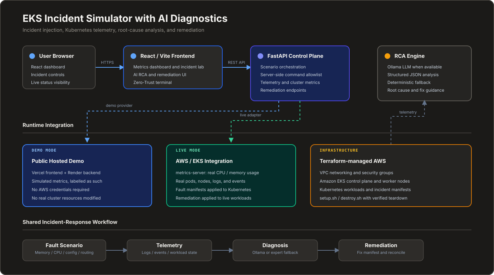
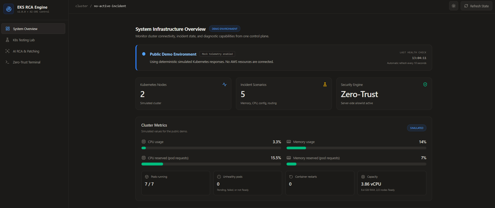
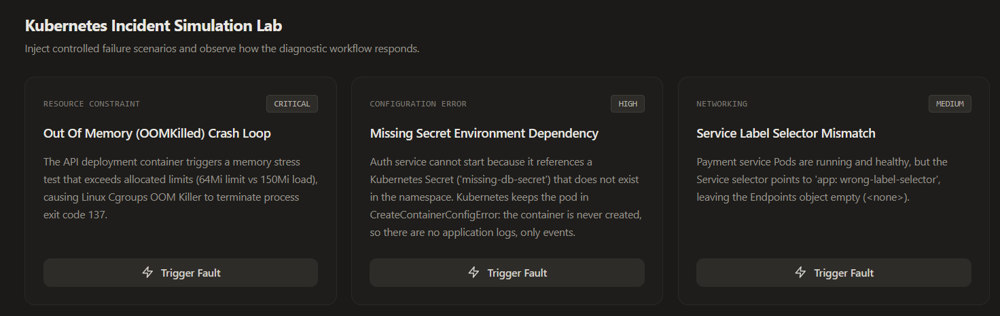
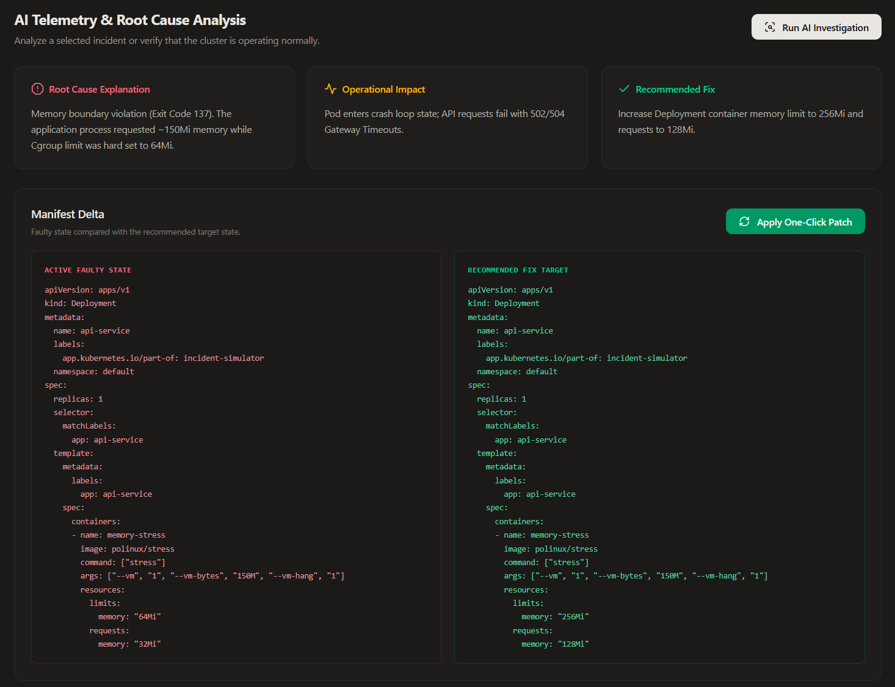
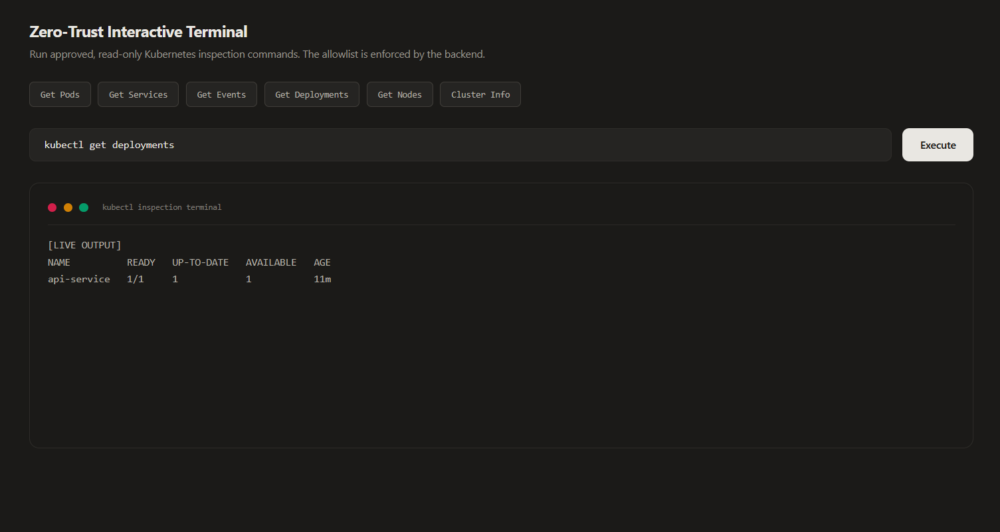

================================================
# EKS Incident Simulator with AI Diagnostics
 


A cloud engineering and SRE platform that provisions an Amazon EKS cluster with Terraform, injects controlled failure scenarios into Kubernetes workloads, collects cluster telemetry, and generates structured Root Cause Analysis with recommended remediation.

The project supports two environments:

- **Demo Mode** — a public, safe experience using deterministic mock data.
- **Live AWS Mode** — a real EKS integration using live Kubernetes nodes, pods, logs, and events.

[Open the Public Demo](https://eks-incident-simulator-ai-diagnosti.vercel.app/)

---

## 🛠 Tech Stack
 
| Category | Technologies |
| :--- | :--- |
| **Cloud Infrastructure** |   |
| **Infrastructure as Code** |  |
| **Container Orchestration** |  |
| **Backend & AI Engine** |    |
| **Frontend Management UI** |    |
| **Automation** |  |
 
---

## 🏗 System Architecture

<p align="center">
  
</p>

The platform is built around a FastAPI control plane that communicates with the React dashboard and connects to one of two runtime environments:

- In **Demo Mode**, it returns realistic deterministic mock responses.
- In **Live Mode**, it connects to a real Kubernetes cluster backed by Amazon EKS.

Both environments use the same frontend workflow and API contract. The difference is the source of the Kubernetes data.

---

## 🎯 What the Platform Does

The application demonstrates an end-to-end Kubernetes incident-response workflow:

1. Select a controlled failure scenario.
2. Inject the faulty workload configuration.
3. Observe the resulting Kubernetes symptoms.
4. Collect logs and Kubernetes events.
5. Generate a structured Root Cause Analysis.
6. Review the recommended remediation.
7. Apply the corrected manifest.
8. Inspect the cluster through a restricted terminal.

This makes the project useful as both an interactive cloud engineering demo and a practical SRE incident simulation tool.

---

## 🚨 Incident Scenarios

### OOMKilled

A workload exceeds its configured memory limit.

The simulator demonstrates how Kubernetes terminates the container when the process exceeds its cgroup memory boundary.

### Missing Secret (`crashloop`)

A workload depends on a Kubernetes Secret that does not exist.

Kubernetes cannot even create the container, so the pod stays in `CreateContainerConfigError` (there are no application logs, only events) until the Secret exists. The scenario id stays `crashloop` for API compatibility.

### Broken Service Routing

A Service selector does not match the labels of the target workload.

The pods may be running, but the Service has no valid endpoints and traffic cannot reach the application.

---

## 🧠 Simulation and Diagnostic Workflow

### 1. Select a Scenario

Choose one of the available Kubernetes failure scenarios from the Testing Lab.

### 2. Trigger the Incident

The backend receives the selected scenario and applies its faulty manifest.

- In **Demo Mode**, the action is simulated.
- In **Live Mode**, the manifest is applied to the connected EKS cluster.

### 3. Observe the Failure

The dashboard presents the resulting workload state, including:

- Pod status.
- Restart counts.
- Kubernetes events.
- Missing service endpoints.
- Node health.
- Workload availability.

### 4. Run the Investigation

The backend collects telemetry from the affected component:

- Recent pod logs.
- Previous container logs when available.
- Kubernetes events.
- Live cluster information.

### 5. Review the RCA

The RCA engine returns:

- Root cause.
- Operational impact.
- Recommended technical fix.
- Analysis source.

When Ollama is available, it can generate the analysis. If Ollama is unavailable or returns an invalid response, the deterministic expert engine provides a reliable fallback.

### 6. Apply the Remediation

The interface displays the faulty manifest next to the recommended fix.

- In **Demo Mode**, remediation is simulated.
- In **Live Mode**, the corrected manifest is applied to Kubernetes.

---

## 🖥 Zero-Trust Interactive Terminal

The dashboard includes a restricted terminal for safe Kubernetes inspection.

The interface provides ready-to-use commands such as:

```text
kubectl get pods
kubectl get services
kubectl get events
kubectl get deployments
kubectl get nodes
kubectl cluster-info
```

Commands are validated on the backend through a strict allowlist. Only approved read-only inspection commands can be executed.

The terminal behaves differently according to the environment:

- **Demo Mode** returns deterministic simulated output.
- **Live Mode** executes approved commands against the connected Kubernetes cluster.
- **Offline** returns a clear connection error instead of pretending to provide live data.

The interface clearly reports the current environment as:

```text
LIVE
DEMO
OFFLINE
```

---

## 📸 Screenshots

### 📊 Dashboard Overview
Provides high-level cluster visibility: node health, pod counts, restarts, capacity, and CPU/memory gauges. In Demo Mode the gauges are clearly labelled as simulated and follow the active incident (for example memory climbs and restarts appear during an OOMKilled incident, and return to normal after remediation); in Live Mode only values the Kubernetes API really provides are shown (live CPU/memory usage comes from metrics-server, which `scripts/setup.sh` installs from the pinned manifest in `k8s/metrics-server/`; until it reports, or if it is missing, Live Mode shows what pods have reserved through their resource requests compared with the nodes' allocatable capacity instead). A light/dark theme toggle is in the top bar.

<p align="center">
  
</p>

---

### 🧪 Incident Simulation Lab
Allows engineers to trigger controlled failure scenarios (OOMKilled, missing Secret, Broken Routing) to simulate real-world SRE incidents.

<p align="center">
  
</p>

---

### 🧠 AI Root Cause Analysis (RCA)
Collects cluster logs and events to automatically generate structured root-cause diagnostics and recommended remediation steps.

<p align="center">
  
</p>

---

### 🔒 Zero-Trust Interactive Terminal
Provides a secure in-browser CLI for inspecting cluster resources using a strict backend command allowlist.

<p align="center">
  
</p>

---

## Public Demo Mode

The public demo is available through the hosted frontend:

[Open the EKS Incident Simulator Demo](https://eks-incident-simulator-ai-diagnosti.vercel.app/)

The frontend communicates with the hosted backend API:

[Open the Demo Backend](https://eks-incident-simulator-with-ai.onrender.com/)

The hosted version runs in Demo Mode:

- It uses deterministic mock Kubernetes data.
- It does not require AWS credentials.
- It does not create AWS resources.
- It does not modify a real EKS cluster.
- It uses the same interface as the Live AWS deployment.

Because the backend uses Render's free hosting tier, it may take a few seconds to wake up after inactivity. The frontend communicates with the backend when it loads, so the first request may take longer than usual.

---

## Option A: Local Demo Mode

To run the mock version locally without AWS, set up the backend once:

```bash
# One-time setup — only needed the first time, or after deleting .venv
cd backend
python3 -m venv .venv
source .venv/bin/activate
pip install -r requirements.txt
```

Then, every time you want to run it:

```bash
cd backend
source .venv/bin/activate
DEMO_MODE=true uvicorn app.main:app --reload --port 8000
```

In a second terminal, set up the frontend once:

```bash
# One-time setup — only needed the first time, or after deleting node_modules
cd frontend
npm install
```

Then, every time you want to run it:

```bash
cd frontend
npm run dev
```

The frontend usually opens at:

```text
http://localhost:3000
```

If port `3000` is already in use, Vite automatically selects another available port and prints the exact URL in the terminal.

Local Demo Mode does not require AWS credentials or a Kubernetes cluster.

---

## Option B: Full AWS / EKS Deployment

Live Mode connects the backend to a real Kubernetes cluster.

### Requirements

- AWS CLI.
- Terraform 1.9 or newer.
- kubectl.
- Python 3.11 or newer.
- Node.js 18 or newer.
- npm.
- curl.
- Linux, macOS, WSL, or another Bash-compatible environment.
- AWS credentials with permission to create the required infrastructure.

Before starting, verify that the AWS CLI is authenticated:

```bash
aws sts get-caller-identity
```

Review the Terraform configuration under:

```text
terraform/
```

Then run the setup script from the repository root:

```bash
chmod +x scripts/setup.sh scripts/destroy.sh
./scripts/setup.sh
```

### Estimated cost

While the cluster runs, expect roughly **0.23-0.25 USD per hour (about 5-6 USD per day)**: the EKS control plane (~0.10), the NAT gateway (~0.045 plus data), and two `t3.medium` nodes (~0.08), plus small items. This is an estimate, not a bill. Leaving the cluster running burns money fast, so run `./scripts/destroy.sh` when you are done.

The setup script shows your AWS account, the region and this cost note, and asks for confirmation before it creates anything (`./scripts/setup.sh --yes` skips the question).

The setup script automatically:

- Checks the required tools (including Terraform 1.9+).
- Imports an existing CloudWatch log group into Terraform if an earlier run left one behind, instead of failing with "already exists".
- Restricts the public EKS API endpoint to your current public IP (override with `EKS_ALLOWED_CIDR=203.0.113.7/32`; if your IP changes, run the script again).
- Runs Terraform.
- Creates or updates the EKS infrastructure.
- Updates the local kubeconfig.
- Waits for Kubernetes to become available.
- Installs metrics-server (one small pod, no extra AWS cost) so the dashboard can show real CPU and memory usage.
- Creates `backend/.venv` if it does not exist.
- Installs backend dependencies when needed.
- Installs frontend dependencies when needed.
- Starts the FastAPI backend and the Vite frontend, each in its own process group, **bound to `127.0.0.1` only** (the live backend has no authentication and can run kubectl against your cluster).
- Prints the actual localhost URLs.
- Reports which phase failed if something goes wrong, and tells you to run `./scripts/destroy.sh` if Terraform may have created resources.

Typical output:

```text
Frontend: http://localhost:3000
Backend:  http://localhost:8000
API docs: http://localhost:8000/docs
```

If port `3000` is already in use, the script displays the alternative URL selected by Vite.

---

## Dependency Installation

The setup script avoids unnecessary installations.

For the backend:

- `backend/.venv` is created only if it does not already exist.
- Python dependencies are installed only when `requirements.txt` has changed.

For the frontend:

- `npm ci` runs only when `frontend/node_modules` is missing.
- Existing frontend dependencies are reused on later runs.

The normal workflow is simply:

```bash
./scripts/setup.sh
```

---

## Stop and Destroy

When the AWS environment is no longer needed, run:

```bash
./scripts/destroy.sh
```

The destroy script automatically:

- Reads the cluster name and region from Terraform and builds its own temporary kubeconfig, so it never acts on whatever kubectl context happens to be active. If the cluster cannot be reached, it skips the Kubernetes cleanup and touches nothing else.
- Stops the Vite frontend and the Uvicorn backend (whole process groups) and checks that the ports are free.
- Deletes only the simulator's own Kubernetes resources, selected by the label `app.kubernetes.io/part-of=incident-simulator`, and any `LoadBalancer` Service (which owns an AWS load balancer that would block VPC deletion).
- Runs `terraform destroy` with up to 3 attempts, because VPC dependency errors are often temporary.
- Verifies the result with a PASS/FAIL list: no resources tagged `Project=AI-Incident-Simulator`, EKS cluster gone, NAT gateways deleted, Elastic IP released, CloudWatch log group gone.
- Removes this cluster's entries from `~/.kube/config`.

Use `./scripts/destroy.sh --yes` to skip the confirmation question.

> The setup and destroy scripts were checked with `shellcheck` and by reading the logic, but have not been run end to end against a real AWS account by the author of this change. Check the PASS/FAIL list after your first destroy.

The script does not delete:

```text
backend/.venv
frontend/node_modules
```

Those are local development dependencies and are preserved for the next setup.

Always destroy unused AWS infrastructure to avoid unnecessary cloud charges.

---

## Tests and CI

Backend tests run in Demo Mode, with no AWS account and no cluster:

```bash
cd backend
pip install -r requirements-dev.txt
python -m pytest
```

The GitHub Actions pipeline runs on every push and pull request:

- Terraform `fmt` and `validate`.
- Python lint and the pytest suite.
- Frontend production build.
- Docker image build, and a check that the container does not run as root.
- CodeQL security analysis (Python and JavaScript), also weekly.
- Dependabot keeps pip, npm, Docker, Terraform and GitHub Actions dependencies up to date.

---

## Design Decisions

- **Terraform state is local on purpose.** This is a single-user, short-lived simulator. A remote backend (S3 and a lock table) would add resources that can outlive `terraform destroy`. Keep `terraform/terraform.tfstate` until the destroy finishes: deleting it leaves the AWS resources orphaned. For a team or a long-lived environment, use a remote backend with locking.
- **The Kubernetes version is pinned** (`kubernetes_version`, default 1.35) to a version in standard support. Versions in extended support cost 0.60 USD/h instead of 0.10 USD/h for the control plane. Check `aws eks describe-cluster-versions` when you update it.
- **Worker nodes use Amazon Linux 2023** (`AL2023_x86_64_STANDARD`) in private subnets behind a NAT gateway. Removing the NAT gateway or moving nodes to public subnets would save money but expose the nodes, so the cost is accepted instead.
- **The CloudWatch log group is managed by Terraform** (7-day retention), so `terraform destroy` removes it.
- **The EKS API endpoint is public but restricted** to your IP by `scripts/setup.sh`. A production cluster would normally use a private endpoint reached through a VPN or bastion.
- **Not included on purpose:** KMS envelope encryption for Kubernetes Secrets (it leaves a key pending deletion after destroy) and a remote Terraform backend. Both are standard in production and would be the next hardening steps.

---

## Security Notes

This project is intended for controlled testing and educational use.

- Never commit AWS access keys or private credentials.
- Do not expose a live EKS-connected backend publicly without authentication.
- Use a dedicated AWS account or sandbox environment.
- Review remediation manifests before applying them.
- Keep the terminal allowlist restrictive.
- Do not run the simulator against production workloads.
- Destroy unused AWS infrastructure after testing.

The public hosted backend should remain in Demo Mode and should not receive credentials that can access a real AWS account or production Kubernetes cluster.

---

## 📜 License

This project is licensed under the MIT License. See the [LICENSE](LICENSE) file for details.